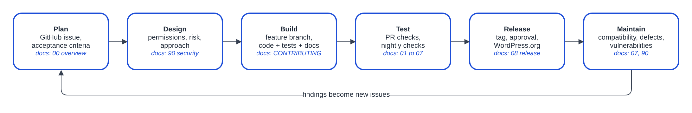
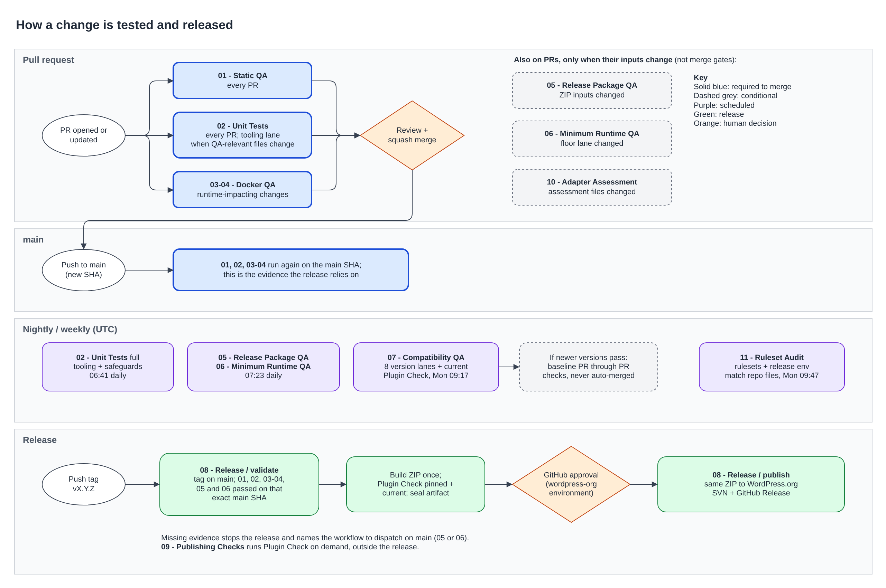

# 00 - SDLC overview

How work moves from an idea or defect to a maintained WordPress.org release,
and how each change is tested on the way. This is the entry point: every other
numbered document covers one GitHub Actions workflow with the same number.

## TL;DR

- **Plan → build → test → release → maintain.** Work starts as a GitHub issue,
  is built on a branch and merges to `main` by squash merge after review.
- **Three checks gate every merge:** `01 - Static QA`, `02 - Unit Tests` and
  `03-04 - Docker QA`. Each is a single summary job that also passes when
  change detection proves a part did not apply (for example, docs-only PRs
  skip Docker QA).
- **Slow checks run when their inputs change, and nightly on `main`:**
  `05 - Release Package QA` tests the installed ZIP and `06 - Minimum Runtime
  QA` tests WordPress 6.9 on PHP 8.0. `07 - Compatibility QA` tests new
  WordPress and MCP Adapter versions weekly and proposes baseline PRs.
- **A release promotes evidence; it does not re-prove it.** Pushing tag
  `vX.Y.Z` runs `08 - Release`, which requires 01–06 to have passed on that
  exact `main` commit, builds the ZIP once, runs Plugin Check, then waits for
  GitHub approval before publishing the same ZIP to WordPress.org and GitHub.
- **Budgets:** PR checks about 20 minutes, docs-only PRs about 5, the release
  job about 15 (excluding the approval wait).
- **The protection is checked too.** `11 - Ruleset Audit` compares the live
  GitHub rulesets and the `wordpress-org` release environment with
  `.github/rulesets/` and `.github/environments/` every week.
- **Humans decide** scope, risk, merges, releases and what to do with findings.
  Automation prepares evidence; it does not approve.

## Lifecycle

| Stage | Purpose | Main artifacts | Read |
| --- | --- | --- | --- |
| Plan | Define the problem, outcome, scope, constraints and evidence of success. | GitHub issue | [Issue templates](../.github/ISSUE_TEMPLATE), [CONTRIBUTING](../CONTRIBUTING.md) |
| Design | Decide behavior, permissions, risks, compatibility and approach before building. | Design notes, acceptance criteria, plan | [90 - Security strategy](90-security-strategy.md) |
| Build | Implement on an issue branch; keep code, tests, docs and changelogs aligned. | Branch, commits, tests, docs | [CONTRIBUTING](../CONTRIBUTING.md), [agent instructions](../.github/copilot-instructions.md) |
| Test | Prove behavior, security, compatibility, transport and package quality. | Local results, check runs, retained artifacts | [01](01-static-qa.md) to [07](07-compatibility-qa.md) |
| Release | Approve, package, publish and verify the exact validated ZIP. | PR, ZIP, approval record, GitHub Release, SVN tag | [08 - Release](08-release.md) |
| Maintain | Detect drift, respond to defects and vulnerabilities, recover safely. | Compatibility PRs, issues, advisories, hotfixes | [07](07-compatibility-qa.md), [90](90-security-strategy.md), [08](08-release.md) |

Security applies at every stage. [91 - CI/CD platform](91-ci-cd-platform.md)
covers the GitHub settings that connect them.

### How a change moves through the lifecycle

1. Open or pick a GitHub issue that describes the problem or outcome.
2. Define scope, constraints, acceptance criteria and open questions.
3. Add design decisions and a plan when risk or complexity warrants it.
4. Implement on an issue branch, with the tests and docs that prove it.
5. Open a PR that links the issue, explains the change and lists what you ran.
6. Pass the required checks and human review.
7. Squash-merge to `main`.
8. Release through the protected release workflow when the change ships in the plugin.
9. Turn defects, vulnerabilities and compatibility findings into new issues.

### Planning depth

Plan in proportion to risk.

| Change type | Expected planning |
| --- | --- |
| Typo or routine maintenance | A clear PR summary; link an issue if one exists. |
| Contained bug fix | Reproduction, expected behavior, affected surface and the regression evidence that proves the fix. |
| Feature or ability change | Problem, outcome, constraints, acceptance criteria, permission implications and a plan. |
| Breaking, destructive, cross-cutting or security-sensitive change | Design decisions, alternatives, threat and permission analysis, compatibility impact, implementation and test plans, and explicit human review before release. |

### Human decision points

Humans remain responsible for:

- accepting an issue and its scope
- resolving open product and design questions
- approving significant risk or compatibility decisions
- reviewing whether a PR meets its intent
- authorizing production publication
- deciding whether findings are fixed, scheduled or dismissed

Automation and AI prepare evidence and run approved steps; they do not replace
these decisions.

## QA at a glance

QA checks the plugin itself: correctness, permissions, response privacy,
WordPress compatibility, MCP interoperability, data integrity and the behavior
of the installed release package. Permissions, privacy and cleanup need
explicit assertions; a successful request alone is not evidence.

WordPress.org approval and listing are outside product QA. Plugin Check and
directory guideline review belong to the release process and are reported
separately from plugin behavior.

### Check map

| No. | Check (summary job) | Workflow file | Runs on | Blocks |
| --- | --- | --- | --- | --- |
| 01 | `01 - Static QA` | `01-static-qa.yml` | Every PR, `main` push, manual | Merge, release |
| 02 | `02 - Unit Tests` | `02-unit-tests.yml` | Every PR, `main` push, nightly, manual | Merge, release |
| 03, 04 | `03-04 - Docker QA` (jobs `03 - Ability Contract QA`, `04 - Full MCP E2E QA`) | `03-04-docker-qa.yml` | Every PR, `main` push, manual; runtime jobs skip for non-runtime changes | Merge, release |
| 05 | `05 - Release Package QA` | `05-release-package-qa.yml` | PRs changing ZIP inputs, nightly, manual | Release |
| 06 | `06 - Minimum Runtime QA` | `06-minimum-runtime-qa.yml` | PRs changing the floor lane, nightly, manual | Release |
| 07 | `07 - Compatibility QA` | `07-compatibility-qa.yml` | Weekly, manual | Baseline promotion |
| 08 | `08 - Release` | `08-release.yml` | Tag `vX.Y.Z`, guarded recovery dispatch | Publication |
| 09 | `09 - Publishing Checks` | `09-publishing-checks.yml` | Manual | Nothing (diagnostic) |
| 10 | `10 - Adapter Assessment` | `10-adapter-assessment.yml` | PRs changing assessment files, manual | Nothing (assessment) |
| 11 | `11 - Ruleset Audit` | `11-ruleset-audit.yml` | Weekly, PRs changing `.github/rulesets/` or `.github/environments/`, manual | Nothing (repository guard) |

Naming rule: file `NN-name.yml`, workflow `NN - Name`, summary job named
exactly like the workflow, other jobs `NN - Name / detail`. The Docker
workers keep their own numbers, `03` and `04`.

The development baseline is WordPress 7.1.3, PHP 8.2 and MCP Adapter 0.7.0,
pinned in `.github/compatibility-versions.json`. The advertised minimums remain
WordPress 6.9 and PHP 8.0.

### When checks run

`scripts/qa-changes.sh` decides whether a change-scoped job runs. Scheduled and
manual runs always run every scope. Git-quoted (unusual) paths always count.

| Scope | Used by | Runs when |
| --- | --- | --- |
| `default` | 02 QA-tooling and CI-safeguard jobs, 06 | Any QA-relevant file changes: source, tests, scripts, workflows, Composer, Compose, `readme.txt`, `CHANGELOG.md`. |
| `runtime` | 03-04 runtime jobs | Any change except known non-runtime paths: docs and Markdown, `tests/unit/`, `.github/` metadata and other workflows, `.wordpress-org/`, release-only scripts. `03-04-docker-qa.yml` and `compatibility-versions.json` always run. |
| `package` | 05 | ZIP inputs: main plugin file, `readme.txt`, `LICENSE`, `.gitattributes`, `assets/`, `.wordpress-org/`, the build, archive and package scripts, and the workflow itself. |

06 also has a workflow path filter, so on PRs it runs only when its workflow,
`scripts/qa-floor.sh` or `tests/fixtures/php80-floor/` change.

| Schedule (UTC) | Workflow |
| --- | --- |
| Daily 06:41 | 02 - Unit Tests (full tooling and safeguards) |
| Daily 07:23 | 05 - Release Package QA, 06 - Minimum Runtime QA |
| Monday 09:17 | 07 - Compatibility QA |
| Monday 09:47 | 11 - Ruleset Audit |

### Merge and release gates

Ruleset `main-ci-gates` (desired state in `.github/rulesets/`, checked weekly by 11) requires `01 - Static QA`, `02 - Unit Tests` and
`03-04 - Docker QA`. Each summary job passes only when change detection
succeeded and every applicable job succeeded, or was skipped because
detection said it did not apply. Failure, cancellation or an unexpected skip
fails it. 05 and 06 follow the same rule but are not merge requirements;
instead, a release requires both to have actually run and passed on the
tagged commit (see [08 - Release](08-release.md)).

### CI budgets and pruning

Keep QA proportionate to what it protects. Budgets are wall-clock targets for
a typical change:

| Path | Budget | Today |
| --- | --- | --- |
| PR checks for a plugin-code change | 20 min | About 16 min; Docker QA and the tooling lane are the longest jobs |
| PR checks for docs-only changes | 5 min | About 2 min |
| Release job, excluding approval wait | 15 min | About 10 min expected; first measured on the next release |

When a change would push a path over budget, say so in the PR and propose
what to move off the critical path (nightly, change-scoped or parallel) before
adding serial work.

Every gate, safeguard or QA-tooling test must name the failure it prevents, in
its docstring, comment or PR description. Review gates quarterly: propose
removing any that have not failed in that period, or that guard against a
failure other checks already catch. Prefer one readable policy test over
byte-for-byte freezes of workflow files.

### Execution location

Run development QA where the coding session runs. A local session uses the
local Docker engine through `scripts/qa-run.sh` and the `qa-local` wrappers; a
cloud session uses its own containers or GitHub Actions. Do not dispatch a
cloud workflow just to replace an available local run. The location changes,
not the assertions: both use the same manifests, runners, pins and package
checks. PR checks still validate the submitted commit. If the environment
cannot run a required check, report it as blocked rather than switching
engines or weakening tests.

### Environment notes

- Docker is the default engine. The Podman API adapter is experimental and
  unverified at runtime; no Podman machine is provisioned automatically.
- Native Windows PHP cannot run the POSIX ownership and mode assertions. Run
  those unit tests in a disposable Linux environment instead of weakening them.
- Git Bash container commands keep `MSYS_NO_PATHCONV=1`; Docker Desktop must be
  running, and fresh image setup needs network access.
- Keep the full unit suite within its 128 MiB memory limit.
- Report missing tools or failed setup; never convert them into skipped
  acceptance.

### Reading failures

Work in check order. Fix static, manifest and security-policy failures (01)
before runtime work; unit failures (02) usually mean helper or error-contract
drift; then Docker QA (03-04), package (05) and minimum runtime (06). Each
check's document has its own "Reading failures" section. Report Plugin Check
findings under publishing, separately from product results. Triage
compatibility failures (07) before changing pins or merge policy.

## Sources of truth

| Record | Source of truth |
| --- | --- |
| Intent, requirements, acceptance criteria, planning | GitHub Issues |
| Recurring policy | This overview and the numbered documents |
| Implementation and review | PRs, commits, review threads and required checks |
| Automated validation | GitHub Actions check runs and retained artifacts |
| Published release | GitHub Release and the matching WordPress.org SVN tag |
| Vulnerability coordination | GitHub private vulnerability reporting and security advisories |

Diagram sources are `docs/images/*.drawio`; edit them in draw.io and re-export
the PNG whenever a workflow, trigger or gate changes.

## Document map

| Doc | Covers |
| --- | --- |
| [01 - Static QA](01-static-qa.md) | Syntax, coding standards, PHPStan ratchet, dependency audit, manifest and security policy, workflow lint |
| [02 - Unit Tests](02-unit-tests.md) | Product and QA-tooling PHPUnit suites, CI safeguards |
| [03-04 - Docker QA](03-04-docker-qa.md) | Ability contract and full MCP E2E against real WordPress; the disposable QA harness |
| [05 - Release Package QA](05-release-package-qa.md) | The built ZIP, installed and tested |
| [06 - Minimum Runtime QA](06-minimum-runtime-qa.md) | WordPress 6.9 on genuine PHP 8.0 |
| [07 - Compatibility QA](07-compatibility-qa.md) | Upstream version lanes and baseline promotion |
| [08 - Release](08-release.md) | Versioning, readiness, publication, recovery, hotfix and rollback |
| [09 - Publishing Checks](09-publishing-checks.md) | On-demand Plugin Check |
| [10 - Adapter Assessment](10-adapter-assessment.md) | Released 2.6.0 ZIP against MCP Adapter 0.6.1 and 0.7.0 |
| [11 - Ruleset Audit](11-ruleset-audit.md) | Live GitHub rulesets and the release environment against `.github/rulesets/` and `.github/environments/` |
| [90 - Security strategy](90-security-strategy.md) | Threat model, permissions, privacy, dependencies, vulnerability response |
| [91 - CI/CD platform](91-ci-cd-platform.md) | Rulesets, permissions, environments, artifacts, PR process |
| [reference/](reference/) | Release history, review checklist, shared helpers, 3.0 migration, Adapter 0.7 assessment |
